# Optimizări 3 - Eliminarea codului și a fluxului de control inutile

## Eliminarea codului inutil

Să ne amintim forma finală a CFG-ului din laboratorul anterior, după **multiple runde alternative** de **numerotare globală a valorilor** și de **eliminare a codului neexecutabil**:

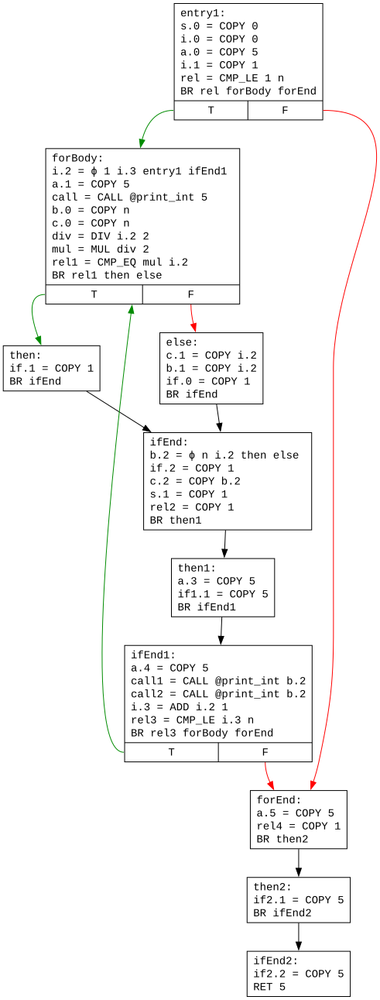

Observăm că, după propagarea copiilor/constantelor, anumite instrucțiuni devin **inutile** (engl. *useless*), în sensul că, deși sunt executabile, ele nu contribuie la comportamentul programului. De exemplu, în blocul `ifEnd2`, odată ce valoarea `5` a lui `if2.2` a fost propagată în instrucțiunea `RET`, instrucțiunea sa de copiere nu mai este utilizată, și ar putea fi eliminată.

O instrucțiune poate fi considerată **utilă**  (engl. *useful*) dacă:

1. **Întoarce** o valoare din funcție (`RET`) sau **invocă** o altă funcție (`CALL`). Acestea se numesc instrucțiuni **critice**.
1. Rezultatul său este **utilizat** de altă instrucțiune utilă. De exemplu, dacă instrucțiunea `b = ADD a 1` a fost deja marcată ca utilă, atunci și instrucțiunea care îl definește pe `a` va fi considerată utilă.
1. Este de **salt condiționat**, dar execuția cel puțin a unei instrucțiuni utile **depinde** de existența sa.

Punctul (3) este mai subtil și necesită detaliere:

* Dacă o instrucțiune utilă se execută **independent** de ramura selectată, atunci, din perspectiva instrucțiunii, saltul condiționat este **inutil**, și ar putea fi înlocuit un unul necondiționat.
* În schimb, dacă execuția instrucțiunii utile **depinde** de ramura selectată (de exemplu, instrucțiunea este întâlnită pe o singură ramură, sau este o instrucțiune ϕ care selectează o valoare în funcție de blocul din care vine fluxul de control), atunci, din perspectiva instrucțiunii, saltul condiționat este **util**.

De exemplu, instrucțiunea `b.2 = ϕ n i.2 then else` din `ifEnd` selectează valoarea lui `b.2` în funcție de blocul din care provine fluxul de control. Prin urmare, instrucțiunile `BR ifEnd` de la finalul lui `then` și `else` devin utile, întrucât permit selecția valorii. Execuția acestora, **depinde**, la rândul său de **saltul condiționat** `BR rel1 then else` din `forBody`, care devine **util**.

Similar, dacă blocul `then` conținea el însuși instrucțiuni **critice** (de exemplu, `CALL`), saltul condiționat de mai sus devenea util.

Presupunând că o instrucțiune a fost deja marcată ca utilă (de exemplu, `BR ifEnd` din `then`), cum ne dăm seama mai precis care este **saltul condiționat anterior** de care **depinde** execuția instrucțiunii utile (de exemplu, `BR rel1 then else` din `forBody`), în vederea marcării lui însuși ca util? În acest sens, introducem conceptual dual celui de dominanță din laboratorul trecut, și anume cel de **postdominanță**.

Un bloc `P` **postdomină** un bloc `B` dacă toate căile de la `B` la blocul de ieșire trec prin `P`. De exemplu, blocul `ifEnd` postdomină blocul `forBody`, dar blocul `then` nu postdomină blocul `forBody`, întrucât există calea prin `else` dinspre `forBody` spre blocul de ieșire, care nu trece prin `then`. Execuția unei instrucțiuni din blocul `then` **depinde** de saltul condiționat de la finalul blocului `forBody` tocmai pentru că **nu îl postdomină**, fiind de fapt primul bloc care iese din sfera de postdominanță a lui `then`; cu alte cuvinte, `forBody` este în **frontiera de postdominanță** a lui `then`.

Frontierele de postdominanță se determină utilizând **arborele de postdominanță**, care nu este altceva decât **arborele de dominanță** al **CFG-ului inversat** (cu arcele inversate). Arborele de postdominanță este reprezentat mai jos:

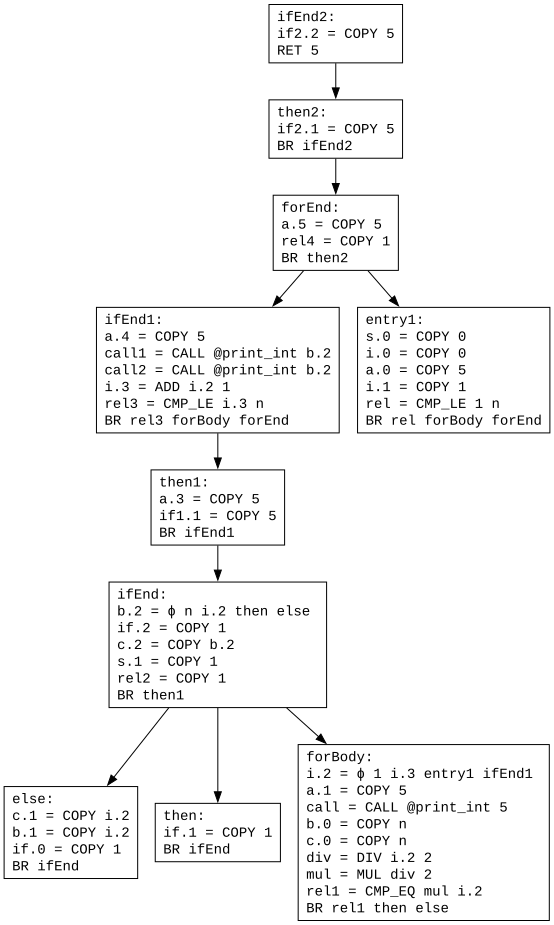

În concluzie, ori de câte ori întâlnim o instrucțiune utilă, trebuie:

1. Să marcăm drept utile instrucțiunile care definesc **operanzii** săi.
1. În cazul **instrucțiunilor ϕ**, să parcurgem **blocurile referite** de instrucțiune și să marcăm drept utile **salturile** de la finalul acestora.
1. Să parcurgem blocurile din **frontiera de postdominanță** a blocului care conține instrucțiunea și să marcăm drept utile **salturile condiționate** de la finalul acestor blocuri.

Pentru implementare, se utilizează o **coadă de instrucțiuni** ce urmează a fi procesate prin prisma **utilității**, care inițial conține instrucțiunile **critice**. Într-un pas, se elimină o instrucțiune, și se aplică pașii de mai sus, care pot introduce noi instrucțiuni utile în coadă.

În final, după ce toate instrucțiunile utile au fost identificate, este necesară **simplificarea** CFG-ului:

1. O instrucțiune **inutilă** care **nu este un salt** este **eliminată**. De exemplu, `if2.2 = COPY 5` din `ifEnd2` poate fi eliminată.
1. **Salturile necondiționate** sunt lăsate ca atare, **indiferent** de utilitatea lor. Ele vor putea fi simplificate de optimizarea din secțiunea de mai jos, *[Eliminarea fluxului de control inutil](#eliminarea-fluxului-de-control-inutil)*.
1. Un **salt condiționat inutil** nu conduce la executarea de instrucțiuni utile pe niciuna dintre ramurile sale, până la întâlnirea **primului postdominator care conține instrucțiuni utile**. Prin urmare, saltul poate fi **înlocuit cu unul necondiționat** către acest bloc.

Eliminând instrucțiunile inutile din CFG-ul nostru, obținem:

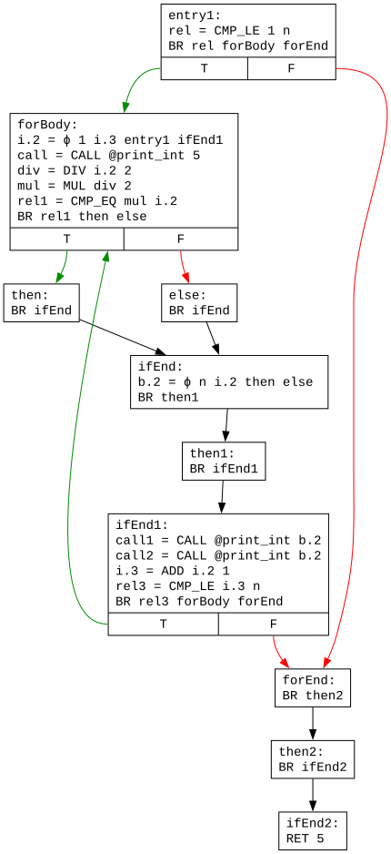

Din păcate, în exemplu, toate salturile condiționate sunt utile, și punctul (3) de mai sus nu poate fi demonstrat. Astfel, pentru a evidenția și acest punct, să ne imaginăm o **variație** a codului original: înlocuim dubla atribuire `b = c = i` cu `b = c = n`, cu efect asupra blocului `else`. CFG-ul devine:

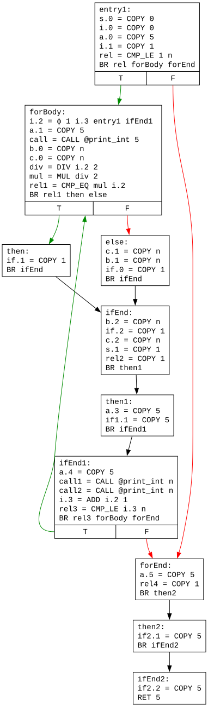

Instrucțiunea ϕ de mai sus devine mai întâi `b.2 = ϕ n n then else` și apoi `b.2 = COPY n`, urmare transformărilor din laboratorul trecut. Efectul este că **niciuna** dintre instrucțiunile din blocurile `then` și `else` nu mai este utilă, și, prin urmare, **nici saltul condiționat** `BR rel1 then else` din `forBody` nu mai este util. În consecință, saltul poate fi **înlocuit cu unul necondiționat** către **primul postdominator care conține instrucțiuni utile**, și anume `ifEnd1`. Aceasta face ca blocurile `then`, `else`, `ifEnd` și `then1` să devină neexecutabile. După eliminarea codului neexecutabil din laboratorul trecut, se obține CFG-ul:

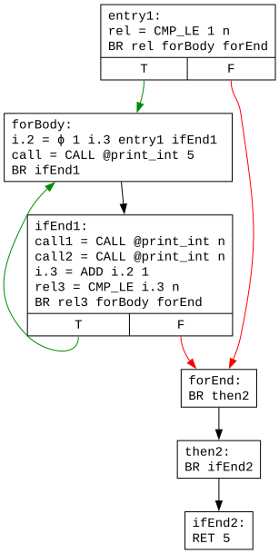

Vom continua expunerea utilizând această variantă.

## Eliminarea fluxului de control inutil

Deși instrucțiunile de salt rămase nu sunt inutile per se (ele contribuie la obținerea comportamentului dorit), CFG-ul poate fi simplificat, aplicând unele dintre transformările de mai jos:

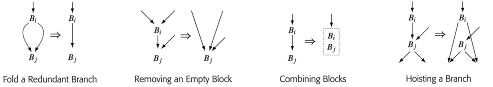

1. **Simplificarea unui salt condiționat redundant** (*fold a redundant branch*): Dacă un bloc `Bi` se termină cu un salt condiționat pentru care ambele ramuri conduc către **același bloc** `Bj`, saltul poate fi înlocuit cu unul necondiționat. Configurația poate apărea după eliminarea blocurilor de pe cele două căi laterale (vedeți următoarea transformare).
1. **Eliminarea unui bloc gol** (*removing an empty block*): Dacă un bloc `Bi` este **gol** și se termină cu un salt necondiționat către un **unic succesor** `Bj`, blocul `Bi` poate fi eliminat, iar predecesorii acestuia conectați cu succesorul `Bj`. Prin ***bloc (logic) gol*** se înțelege un bloc care conține doar un salt și eventuale instrucțiuni ϕ (nu absența completă a instrucțiunilor); este cazul blocurilor `forEnd` și `then2` din exemplul anterior. Configurația poate apărea după eliminarea celorlalte instrucțiuni din bloc ca inutile. Observați că, în urma acestei transformări, blocul `Bj` poate căpăta **mai mult de doi predecesori**, ceea ce necesită actualizarea corespunzătoare a instrucțiunilor ϕ din `Bj` (vedeți secțiunea *[Exemple suplimentare](#exemple-suplimentare)*).
1. **Combinarea unor blocuri** (*combining blocks*): Dacă blocul `Bi` se termină cu un salt necondiționat către un **unic succesor** `Bj`, iar `Bj` are ca **unic predecesor** `Bi`, cele două pot fi combinate într-unul singur. Configurația poate apărea după ce `Bi` a pierdut succesori și/sau `Bj` a pierdut predecesori (de exemplu, deveniți neexecutabili).
1. **Ridicarea unui salt condiționat** (*hoisting a branch*): Dacă blocul `Bi` se termină cu un salt necondiționat către un **unic succesor** `Bj`, iar acesta conține doar un **salt condiționat**, saltul necondiționat de la finalul lui `Bi` poate fi înlocuit cu o copie saltului condiționat de la finalul lui `Bj`. Astfel, se evită secvența de **două salturi consecutive** (către și dinspre `Bj`). Observați că:
    * Blocul `Bi` nu poate fi gol, pentru că ar fi fost eliminat de transformarea (2).
    * Blocul `Bj` nu poate avea ca unic predecesor `Bi`, pentru că ar fi fost combinat cu `Bi` de transformarea (3). `Bj` rămâne cu cel puțin un predecesor după aplicarea transformării.

CFG-ul poate fi parcurs în **postordine**, iar transformările de mai sus pot fi încercate exact în **ordinea** de mai sus asupra aceluiași bloc curent, întrucât mai multe ar putea fi aplicabile. De exemplu, după simplificarea unui salt condiționat redundant, un bloc ar putea fi combinat cu succesorul.

Primul bloc prelucrat este `then2`, pentru care se aplică **eliminarea sa ca bloc gol**, iar predecesorul său, `forEnd`, este conectat la succesor, `ifEnd2`, obținându-se:

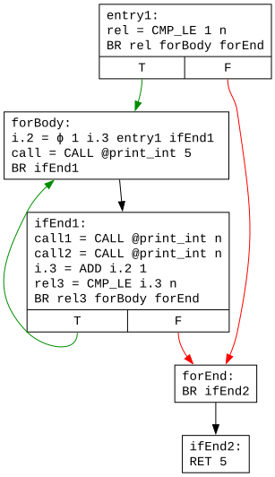

Următorul bloc prelucrat este `forEnd`, care este de asemenea **eliminat ca bloc gol**, cu refacerea legăturilor dintre `entry1` și `ifEnd1`, pe de o parte, și `ifEnd2`, pe de alta:

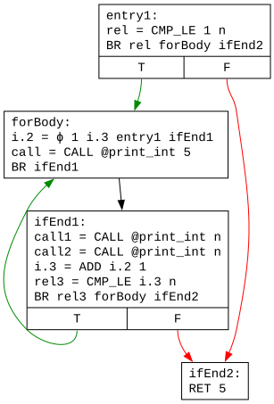

Următorul bloc prelucrat este `forBody`, care posedă un **unic succesor**, `ifEnd1`, care la rândul său îl are pe `forBody` ca **unic predecesor**, și prin urmare poate fi **combinat** cu acesta. Odată ce instrucțiunile din `forBody`, cu excepția saltului necondiționat de la final, sunt copiate la începutul lui `ifEnd1`, `forBody` devine gol și poate fi eliminat. După o rundă de eliminare a codului neexecutabil din laboratorul anterior, se obține:

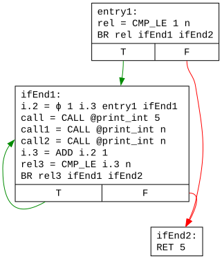

În general, **ciclicitatea** CFG-urilor impune **multiple iterații** de eliminare a fluxului de control inutil.

## Exemple suplimentare

**Eliminarea unui bloc gol** comportă o subtilitate care merită evidențiată. Să revenim la exemplul din laboratorul anterior, în forma imediat de după eliminarea codului inutil:

Aparent, blocurile `then` și `else` satisfac properietatea de bloc gol, și ar putea fi eliminate. Dacă am realiza într-adevăr acest lucru, instrucțiunea `b.2 = ϕ n i.2 then else` din blocul `ifEnd` ar deveni `b.2 = ϕ n i.2 forBody forBody`, ceea ce ar însemna că din același bloc `forBody` ar veni două valori diferite pentru `b.2`. Problema constă în aglutinarea a două căi diferite ale fluxului de control într-una singură. Prin urmare, ne abținem de la aplicarea transformării în cazul blocurilor `then` și `else`.

Problema este semnalată și de faptul că cele două blocuri au fost deja marcate ca **utile** în urma eliminării codului inutil, întrucât sunt referite de instrucțiunea ϕ. Dacă un bloc gol nu este referit de o instrucțiune ϕ, cum este cazul lui `then1`, `forEnd` și `then2`, el poate fi eliminat fără probleme.

Analiza de mai sus implică oare imposibilitatea eliminării unor blocuri goale referite de instrucțiuni ϕ? Din fericire, nu, dar trebuie să stabilim condițiile în care putem realiza eliminarea în siguranță. Situația descrisă mai sus sugerează intuitiv că putem elimina un bloc cât timp **nu suprapunem** căi diferite ale fluxului de control. De exemplu, în cazul blocului `then`, problema constă în faptul că înlocuirea căii `forBody - then - ifEnd`, cu calea directă `forBody - ifEnd` nu ia în calcul existența unei căi alternative `forBody - else - ifEnd`, care nu include `then`. Cu alte cuvinte, problema apare pentru că `then` nu postdomină `forBody`.

Dacă blocul candidat pentru eliminare (ne referim la blocurile referite de instrucțiuni ϕ, pentru că celelalte nu ridică probleme) își **postdomină toți predecesorii**, înseamnă că acele căi converg natural în blocul respectiv, și nu există pericolul unei suprapuneri induse artificial de eliminarea blocului. Bineînțeles că operanzii instrucțiunilor ϕ din succesorul blocului eliminat trebuie actualizați pentru a reflecta noii predecesori, care pot fi acum mai mulți de doi!

Să demonstrăm aceste situații pe un exemplu dedicat:

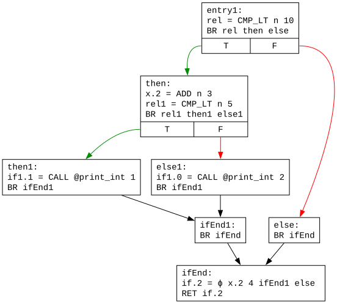

Blocul `ifEnd1`, deși util, fiind referit de instrucțiunea ϕ din `ifEnd`, își postdomină toți predecesorii, `then1` și `else1`, și poate fi eliminat. În consecință, în instrucțiunea ϕ, operandul `x.2`, corespunzător acestui bloc, este duplicat pentru a acomoda cei doi predecesori noi, `then1` și `else1`, în locul lui `ifEnd1`. Observați că blocul `ifEnd` are acum trei predecesori:

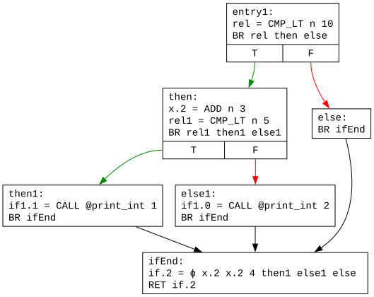

O variație mai interesantă a exemplului este următoarea:

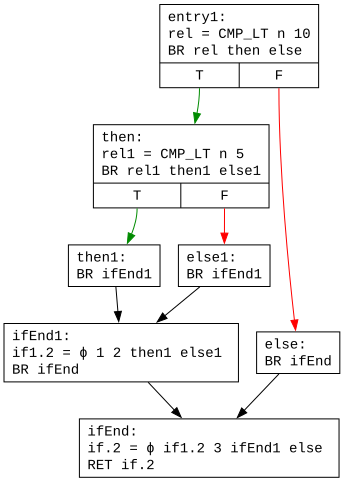

De data aceasta, blocul `ifEnd1` posedă el însuși o instrucțiune ϕ, care, în urma eliminării blocului, trebuie integrată cu instrucțiunea ϕ din `ifEnd`:

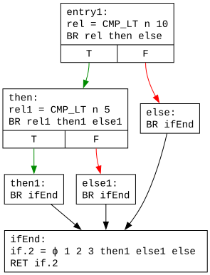

În final, să demonstrăm și transformarea de **ridicare a unui salt condiționat**, pornind de la următorul CFG:

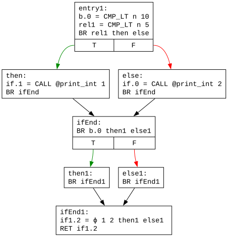

Blocul `then` conține un salt necondiționat către blocul `ifEnd`, care la rândul său conține doar un salt condiționat. Prin urmare, cele două salturi consecutive pot fi evitate înlocuind saltul necondiționat de la finalul lui `then` cu o copie a saltului condiționat de la finalul lui `ifEnd`, astfel încât `then` să continue direct cu blocurile `then1` și `else1`:

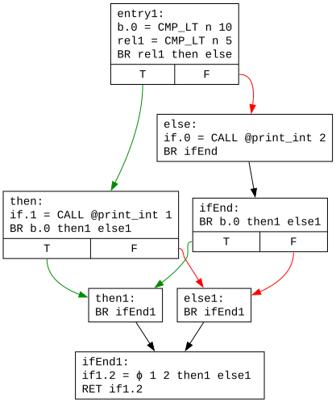

Observați că `ifEnd` continuă să mai aibă un predecesor, pe `else`, după transformare (altfel ar fi fost combinat cu `then`). Din moment ce `else` rămâne singurul predecesor al lui `ifEnd`, poate fi combinat cu acesta, rezultând:

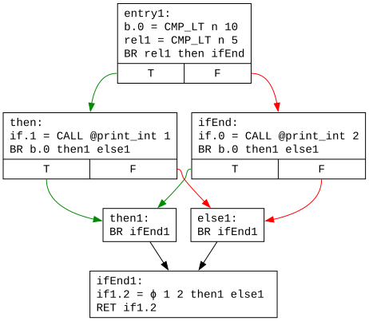

## Cerințe

1. Implementați **eliminarea codului inutil** în clasa `UselessCodeElimination` din pachetul `optim`. Exemplul principal din descrierea laboratorului corespunde funcției `f` din fișierul `elimination.txt`.
1. **Eliminarea fluxului de control inutil** este deja implementată în clasa `UselessControlFlowElimination` din pachetul `optim`. Reconstituiți secvențele de transformări din descrierea laboratorului.
    * Începeți cu funcția `f` de mai sus.
    * Apoi consultați funcțiile `removeEmptyBlock`, `removeEmptyBlockPhi` și `hoistBranch` din fișierul `elimination.txt`, care corespund exemplelor din secțiunea *[Exemple suplimentare](#exemple-suplimentare)*.
    * Pentru a schimba funcția optimizată, modificați constanta `FUNCTION_NAME` din metoda `main` a clasei `Test`.

Numele fișierelor DOT utilizează următoarele acronime:

* GVN = Global Value Numbering
* UCE = Unreachable Code Elimination
* UsCE = Useless Code Elimination
* UsCFE = Useless Control Flow Elimination
