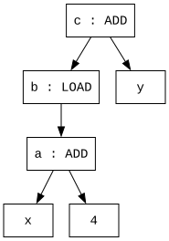
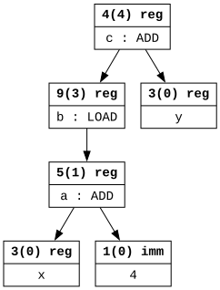
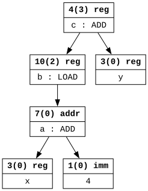

# Selecția instrucțiunilor țintă pe baza codului intermediar

## Introducere

Odată ce codul intermediar a fost optimizat, pasul următor constă în **selecția** instrucțiunilor țintă (de limbaj de asamblare) care să implementeze codul intermediar. O abordare simplă o reflectă pe cea prezentată în laboratoarele anterioare, și anume stabilirea câte unui **șablon** cu una sau mai multe instrucțiuni țintă care să implementeze **fiecare instrucțiune** de cod intermediar. Din păcate, deși ușor de implementat, este destul de probabil ca această strategie să **nu valorifice** corespunzător repertoriul de instrucțiuni oferit de arhitectura fizică, care pot trata multiple situații particulare, moduri de adresare etc. De exemplu, o anumită arhitectură fizică ar putea expune o instrucțiune expresivă, cu multiple efecte, care să implementeze compact o **întreagă secvență** de instrucțiuni de cod intermediar. O abordare locală, la nivelul unei singure instrucțiui de cod intermediar, **nu ar detecta** o astfel de oportunitate.

Prin urmare, o posibilă îmbunătățire constă în observarea **contextului** în care apare o instrucțiune de cod intermediar, luând în calcul **secvențe de instrucțiuni** în locul instrucțiunilor izolate. Acest lucru se poate realiza prin intermediul unei **ferestre glisante**, în cadrul căreia să se identifice anumite șabloane, care ar putea fi codificate particular. Unul dintre neajunsurile abordării este că **dimensiunea prea redusă** a ferestrei poate împiedica detectarea unui anumit șablon, dacă instrucțiunile care compun șablonul apar la distanță prea mare.

Abordarea pe care ne concentrăm pornește de la **graful SSA** pe care îl definește implicit o secvență de instrucțiuni în forma SSA (a nu se confunda cu CFG-ul):

* **Nodurile** sunt simboluri.
* Un **arc orientat** dintre nodurile `x` și `y` indică prezența unui operand `y` în cadrul instrucțiunii care îl definește pe `x`.

În blocul de mai jos, considerăm că `x` și `y` sunt definite în exteriorul blocului, iar instrucțiunea `LOAD` tratează operandul ca pe o adresă de memorie, de unde citește conținutul (similar cu instrucțiunea MIPS `lw`).

```
a = ADD x 4
b = LOAD a
c = ADD b y
```

Graful SSA aferent blocului, în particular chiar un **arbore**, este următorul:



Astfel, putem formula problema selecției instrucțiunilor țintă care implementează un graf ca cel de mai sus ca o problemă de **acoperire** (engl. *tiling*) a acestuia. Această abordare este **imună** la distanța dintre instrucțiuni, spre deosebire de strategia bazată pe fereastră glisantă.

## Selecția instrucțiunilor ca problemă de acoperire a unui graf

În vederea acoperirii grafului, definim o serie de **șabloane** în formă de graf, cu care încercăm să acoperim **subgrafuri**, din aproape în aproape, într-o manieră *bottom-up*, până la acoperirea întregului graf de interes. Este posibil să existe **multiple acoperiri** ale grafului, fiecare cu diverse **costuri** în termeni de viteză de execuție, lungime a codului etc. Odată fixat un obiectiv (de obicei, viteza de execuție), ne interesează o acoperire de cost **minim** sau cât mai mic, dacă minimul nu poate fi determinat eficient.

De exemplu, pornind de la frunzele arborelui de mai sus, putem remarca următoarele:

1. Abordare mioapă:
    * Ignorând contextul înconjurător particular, dar fiind preocupați să facem universal accesibile mai sus valorile frunzelor, putem trata atât `x`, cât și `4` ca valori aflate în **registre**, fapt ce duce la generearea instrucțiunii MIPS `li four 4`, unde `four` este un simbol **proaspăt creat** pentru a reține valoarea `4`. Vizitarea lui `x` nu produce instrucțiuni.
    * Mai sus, la nivelul lui `a`, din moment ce ambii termeni sunt disponibili în **registre**, putem genera instrucțiunea `add a x four`.
    * La nivelul lui `b`, avem disponibilă adresa finală în **registrul** `a` și putem genera instrucțiunea `lw b 0(a)`.
    * În final, la nivelul lui `c`, termenii sunt de asemenea disponibili în **registre**, și generăm instrucțiunea `add c b y`.
    * Secvența finală de instrucțiuni este:
    
        ```
        li four 4
        add a x four
        lw b 0(a)
        add c b y
        ```

1. Abordare mai extinsă:
    * Dacă ținem cont `4` poate apărea ca operand imediat în cadrul unei instrucțiuni MIPS, ca `addi`, ne abținem să îl salvăm imediat pe `4` într-un registru, și îl interpretăm ca un **imediat**. Astfel, nu generăm nicio instrucțiune la nivelul frunzelor.
    * Mai sus, la nivelul lui `a`, generăm direct instrucțiunea `addi a x 4`.
    * La următoarele două niveluri nu se modifică nimic, obținând în final secvența de mai jos, cu o instrucțiune **mai scurtă**:

        ```
        addi a x 4
        lw b 0(a)
        add c b y
        ```

1. Abordare și mai extinsă:
    * Dacă ținem cont că însăși suma dintre `x` și `4` poate reprezenta calculul cu deplasament constant al unui adrese, ne abținem să depunem valoarea lui `a` într-un registru și o interpretăm ca pe o **adresă**. Astfel, nu generăm nicio instrucțiune pentru `a`.
    * Mai sus, la nivelul lui `b` generăm direct instrucțiunea `lw b 4(x)`.
    * La următorul nivel nu se modifică nimic, obținând în final secvența de mai jos, cu încă o instrucțiune **mai scurtă**, și din care `a` **dispare**:

        ```
        lw b 4(x)
        add c b y
        ```

Observați că, deși generăm deja instrucțiuni MIPS, operanzii sunt tot **simboluri** din codul intermediar. Alocarea registrelor fizice constituie o etapă separată, care nu este discutată în acest laborator.

În urma analizei de mai sus, conchidem următoarele:

* O decizie avantajoasă nu se poate realiza la un nivel pur local, fără a contempla contextul înconjurător. Prin urmare, luăm în calcul **toate acoperirile** unui subgraf, astfel încât, la nivelurile superioare, deciziile să integreze o plajă cât mai largă de opțiuni.
* Este necesară definirea unor **interpretări** posibile ale rezultatului unei subexpresii, pentru a putea comunica opțiunile către nivelul superior din graf.

În cele ce urmează, utilizăm trei **interpretări** (engl. *storage class*): *registru*, *adresă* și *imediat*. Fiecare mod de acoperire a unui subgraf va  fi descris de câte o **regulă**, cu următoarele componente:

1. O **parte stângă** (engl. *left-hand side*, LHS), corespunzătoare unei **interpretări**, e.g. *registru*.
1. O **parte dreaptă** (engl. *right-hand side*, RHS), corespunzătoare unui **șablon** în formă de graf.
1. O **acțiune**, corespunzătoare secvenței de **instrucțiuni MIPS** generate dacă acea regulă se aplică.
1. Un **cost** estimat al secvenței de mai sus (număr de cicluri, număr de instrucțiuni etc.).

**Regulile** pe care folosim în laborator sunt următoarele:

|Număr|LHS|RHS|Acțiune|Cost|
|-----|---|---|-------|----|
|1|`immediate`|`LITERAL`|-|0|
|2|`register`|`LITERAL`|`li regLit <literal>`|1|
|3|`register`|`NAME`|-|0|
|4|`register`|`ADD register1 register2`|`add <register> <register1> <register2>`|1|
|5|`register`|`ADD register1 immediate2`|`addi <register> <register1> <immediate2>`|1|
|6|`register`|`ADD immediate1 register2`|`addi <register> <register2> <immediate1>`|1|
|7|`address`|`ADD register1 immediate2`|-|0|
|8|`address`|`ADD immediate1 register2`|-|0|
|9|`register`|`LOAD register1`|`lw <register> 0(<register1>)`|2|
|10|`register`|`LOAD address1`|`lw <register> <address1.immediate>(<adddress1.register>)`|2|

De exemplu, **semnificația** regulii 5 este următoarea: dacă nodul curent utilizează un operator `ADD`, iar cei doi copii ai săi pot fi interepetați ca un registru și un imediat (RHS), în urma aplicării recursive a altor reguli pentru aceștia, atunci se poate genera instrucțiunea `add` aferentă (acțiunea), cu timpul de execuție estimat de 1 ciclu (costul), iar nodul curent poate fi văzut la nivelurile superioare ca un registru (LHS).

Parantezele unghiulare desemnează simbolurile asociate interpretărilor (`x`, `4` etc.), iar punctul (vezi regula 10) introduce o componentă a unei interpretări.

Regula 6 tratează cazul în care operanzii imediat și registru ai unei adunări apar în **ordine inversă** față de regula 5. Totuși, observați că acțiunea este scrisă în așa fel încât cei doi operanzi să respecte specificul instrucțiunii `addi`, care așteaptă mai întâi un registru și apoi un imediat.

Setul de reguli amintește de o **gramatică**, în care regulile reprezintă **producții** de forma `LHS → RHS`. Interpretările (`register` etc.) corespund **neterminalilor**, iar natura frunzelor (`LITERAL` - literal întreg, `NAME` - nume extern) și operatorii (`ADD` etc.), **terminalilor**.

Spre deosebire de etapa de analiză sintactică, unde neambiguitatea gramaticii este vitală, gramatica de mai sus este cu siguranță **ambiguă**, iar acest lucru este de fapt **dezirabil**, pentru a oferi cât mai multă flexibilitate în găsirea unei acoperiri de cost cât mai mic. De exemplu, regulile 5 și 7, pe de o parte, și 6 și 8, pe de alta, au același RHS.

Regulile se împart în două **categorii**:

* Reguli ***terminale***, dedicate **frunzelor**, cu un singur terminal în RHS. Este cazul regulilor 1-3.
* Reguli ***cu operator***, dedicate **instrucțiunilor**. Cu excepția operatorului unic, toate componentele RHS sunt neterminali. Este cazul celorlalte reguli.

Observați că cele două categorii de mai sus **împiedică** definirea unor reguli de forma:

* `register → ADD register1 LITERAL2`, în care apare încă un terminal pe lângă operator.
* `register → LOAD (ADD register1 immediate2)`, în care operandul lui `LOAD` este radiografiat la rândul său.

Din fericire, constrângerile **nu reduc** inerent expresivitatea regulilor, cele interzise de mai sus putând fi simulate prin introducerea unor neterminali suplimentari. Scopul constrângerilor este de **simplificare** a algoritmului de potrivire a regulilor cu subgrafurile.

Revenind la exemplul din *[Introducere](#introducere)*, să vedem cum ar arăta acoperirile corespunzătoare celor trei abordări descrise. În partea superioară a fiecărui nod sunt reprezentate îngroșat numărul regulii, costul total al regulii curente și al copiilor în paranteze și interpretarea produsă de regulă: `număr(cost) interpretare`.

1. Abordarea mioapă:

    

1. Abordarea mai extinsă:

    

1. Abordarea și mai extinsă:

    

Se observă că cea mai scurtă secvență MIPS, cea de două instrucțiuni, are costul total 3.

În exemplul de mai sus, graful expresiei este chiar un **arbore**, fapt care simplifică semnificativ găsirea acoperirii de cost minim. Din moment ce fiecare nod, cu excepția rădăcinii, are **exact un părinte**, problema acoperirii manifestă **substructură optimală** relativ la fiecare interpretare în parte a unui nod, și poate fi rezolvată prin **programare dinamică** în timp **polinomial**.

În general, graful poate **să nu fie un arbore**, dacă aceeași subexpresie este referită de mai multe expresii diferite. Situația poate apărea după eliminarea subexpresiilor comune și propagarea copiilor (*copy propagation*). În prezența **mai multor părinți** ai unui nod, pot apărea **conflicte** între acoperirile optime ale părinților; de exemplu, un părinte necesită pentru acoperirea sa optimă o interpretare a copilului ca *registru*, iar celălalt, ca *adresă*. Însă este de preferat ca acel copil să aibă o unică interpretare (și, deci, implementare), care să satisfacă toți părinții simultan, și nu este clar cum alegerea unei interpretări afectează optimul global. Astfel, pe un graf oarecare, problema acoperirii devine **NP-dură**, și sunt necesare euristici.

Ne vom limita în continuare la prezentarea algoritmului pe **arbori**.

## Algoritmul de acoperire pentru arbori

Utilizăm o variantă didactică a algoritmului, care generează **toate acoperirile** posibile ale nodurilor din arbore. Algoritmul utilizează un **tabel**, cu câte o **linie** pentru fiecare **nod** din arbore, și câte o **coloană** pentru fiecare **interpretare**. La intersecția dintre un nod `n` și o interpretare `i` se trec toate instanțele de reguli care acoperă subarborele cu rădăcina `n` pentru a produce interpretarea `i`.

Algoritmul este următorul:

* Dacă nodul curent corespunde unei **frunze**, se utilizează regulile **terminale**.
* Dacă nodul curent corespunde unei **instrucțiuni**, se acoperă mai întâi recursiv **toți copiii** neacoperiți deja, după care se testează potrivirea nodului curent cu regulile **cu operator**. Având în vedere că pentru fiecare copil ar putea exista multiple instanțe de reguli chiar și pentru aceeași interpretare așteptată de părinte, instanțele de reguli ale părintelui se construiesc pe baza unui **produs cartezian** al mulțimilor de instanțe de reguli ale copiilor.

Pentru exemplul din *[Introducere](#introducere)*, tabelul arată astfel, unde fiecare intrare indică regula cu costul în paranteze:

|Nod|`register`       |`address`|`immediate`|
|---|-----------------|---------|-----------|
|`x`|3(0)             |         |           |
|`4`|2(1)             |         |1(0)       |
|`a`|4(2), 5(1)       |7(0)     |           |
|`b`|9(4), 9(3), 10(2)|         |           |
|`y`|3(0)             |         |           |
|`c`|4(5), 4(4), 4(3) |         |           |

De exemplu, cele trei instanțe de reguli ale lui `c` se obțin prin produsul cartezian al instanțelor de reguli pentru `b` și pentru `y`.

În practică, este suficient să păstrăm doar instanța de **cost minim** din **fiecare coloană**, nu de pe întreaga linie, întrucât trebuie să conservăm toate interpretările distincte ale unui nod. În această variantă, tabelul ar deveni:

|Nod|`register`       |`address`|`immediate`|
|---|-----------------|---------|-----------|
|`x`|3(0)             |         |           |
|`4`|2(1)             |         |1(0)       |
|`a`|5(1)             |7(0)     |           |
|`b`|10(2)            |         |           |
|`y`|3(0)             |         |           |
|`c`|4(3)             |         |           |

Observați că, deși pentru `a`, instanța de regulă cu costul minim de pe întreaga linie este 7(0), din coloana `address`, **păstrăm** și intrarea 5(1) din coloana `register` pentru că altfel riscăm să nu putem satisface interpretarea `register` așteptată de un posibil părinte.

## Detalii de implementare

Clasele necesare implementării se găsesc în schelet în pachetul `selection`:

* Clasa `AssemblyInstruction` codifică o instrucțiune de **limbaj de asamblare** și este similară clasei `Instruction` din pachetul `irgen`. Reține o listă de operanzi reprezentați ca simboluri.
* Clasa `MIPSInstruction` moștenește clasa de mai sus și desemnează o **instrucțiune MIPS**.
* Enumerarea `MIPSInstructionType` surprinde tipurile posibile ale **instrucțiunilor MIPS**.
* Enumerarea `Terminal` surpinde tipurile posibile de **terminali** care apar în regulile terminale. Este vorba despre literali întregi și nume externe, care nu corespund unei instrucțiuni SSA (de exemplu, parametri formali).
* Enumerarea `StorageClass` corespunde **interpretărilor** unei expresii: *registru*, *adresă* sau *imediat*.
* Clasa `Rule` este **abstractă** și constituie baza reprezentării celor două categorii de **reguli**.
* Clasa `RuleInstance` este **abstractă** și **internă nestatică** clasei `Rule` și constituie baza reprezentării instanțelor celor două categorii de **reguli**. Este o clasă internă nestatică întrucât instanțele (în sens POO) sale nu pot exista în afara instanțelor clasei `Rule`.
* Clasa `TerminalRule` moștenește clasa `Rule` și reprezintă o regulă **terminală**.
* Clasa `TerminalRuleInstance` moștenește clasa `RuleInstance` și reprezintă o instanță a unei reguli **terminale**.
* Clasa `OperatorRule` moștenește clasa `Rule` și reprezintă o regulă **cu operator**.
* Clasa `OperatorRuleInstance` moștenește clasa `RuleInstance` și reprezintă o instanță a unei reguli **cu operator**.
* Clasa `Tiler` („acoperitor”) implementează algoritmul de **acoperire**.
* Clasa `Main` definește cele 10 reguli din descrierea laboratorului, aplică algoritmul de acoperire pe exemplul discutat și afișează toate acoperirile identificate.

În general, unui membru de tipul `Terminal` dintr-o regulă îi corespunde un membru `Symbol` din instanța acelei reguli, iar unui membru de tipul `StorageClass` îi corespunde un membru de tipul `Symbol` sau `RuleInstance`.

## Cerințe

1. Inspectați **implementările** claselor.
1. Analizați definițiile celor **10 reguli** din metoda `main`.
1. Implementați cele două metode `match` supraîncărcate din clasa `Tiler`, pentru potrivirea cu reguli terminale, respectiv cu operator. Asigurați-vă că acoperirile afișate la consolă reflectă conținutul fișierului `reference.txt`.
